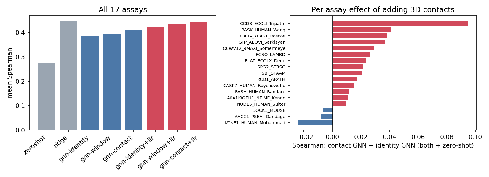

# Does a residue-contact graph add information beyond a protein language model for single-substitution effect prediction?

## Abstract

We ask whether a graph neural network over a protein's residue-contact graph improves prediction of single amino-acid substitution effects beyond ESM-2 (35M parameters). Using 17 ProteinGym v1.3 deep mutational scanning assays and 5-fold cross-validation that holds out whole sequence positions, we compare zero-shot ESM-2 scores, ridge regression on ESM-2 embeddings, and three GNNs sharing one architecture but differing in graph (identity, sequence window, 3D contacts). Contacts give a small, consistent gain over the matched no-structure controls (about +0.02 Spearman; contact vs identity +0.024, 95% CI [+0.010, +0.040], 13/17 assays), but ridge regression performs as well as the best GNN (contact GNN with zero-shot input vs ridge: -0.002, CI [-0.033, +0.029]).



## 1. Question

Does 3D contact structure add predictive signal for mutation effects once a protein language model is available, and does a GNN extract that signal better than a linear model on the same embeddings?

## 2. Methods

**Data.** 17 [ProteinGym](https://proteingym.org) v1.3 deep mutational scanning assays, single substitutions only, with AlphaFold structures from ProteinGym. Assays were drawn by a seeded random sample (seed 0), stratified by selection type, from those small enough for CPU work (at most 350 residues, 800 to 6000 single mutants) whose structure spans the whole sequence. The sample is Stability 5, Activity 5, Organismal fitness 4, Expression 2 and Binding 1. More binding and expression assays were requested, but only 1 and 5 passed the filter, so the subset is 17, not 20.

**Language model.** `esm2_t12_35M_UR50D`. Zero-shot scores are wild-type marginals, `log p(mutant) - log p(wild type)`, from one forward pass over the unmasked wild type.

**Evaluation.** 5-fold cross-validation holding out whole positions, so a model is never tested on a site it saw other substitutions of. Out-of-fold predictions are pooled and scored by per-assay Spearman correlation, then averaged over 3 split seeds. Paired differences use 95% bootstrap intervals over assays.

**Models.**

| model | inputs |
|---|---|
| `zeroshot` | ESM-2 log-likelihood ratio, no training |
| `ridge` | ESM embedding of the site, wild-type and mutant one-hots, zero-shot score; regularisation chosen by internal CV |
| `gnn-identity` | GNN where every residue sees only itself |
| `gnn-window` | same GNN, residues connected to sequence neighbours within ±4 |
| `gnn-contact` | same GNN, residues connected by 3D contacts (CA-CA < 8 Å) |
| `+llr` variants | the above with the zero-shot score as an extra input to the prediction head |

The three GNNs differ only in the graph, so any gain of `contact` over `identity` and `window` comes from structure rather than capacity. Unit tests check that the identity graph ignores other residues and that the contact graph passes information only between contacting residues.

## 3. Results

Mean Spearman over 17 assays:

| model | mean | median |
|---|---|---|
| zeroshot | 0.275 | 0.255 |
| ridge | 0.446 | 0.430 |
| gnn-identity | 0.387 | 0.400 |
| gnn-window | 0.395 | 0.396 |
| gnn-contact | 0.411 | 0.403 |
| gnn-identity+llr | 0.424 | 0.438 |
| gnn-window+llr | 0.433 | 0.432 |
| gnn-contact+llr | 0.445 | 0.431 |

Paired differences across assays (95% bootstrap CI over assays):

| comparison | mean diff | 95% CI | wins |
|---|---|---|---|
| contact vs identity | +0.024 | [+0.010, +0.040] | 13/17 |
| contact vs sequence window | +0.016 | [+0.008, +0.026] | 14/17 |
| contact vs identity (+ zero-shot) | +0.021 | [+0.010, +0.034] | 14/17 |
| contact vs sequence window (+ zero-shot) | +0.011 | [+0.002, +0.023] | 10/17 |
| contact GNN + zero-shot vs ridge | -0.002 | [-0.033, +0.029] | 9/17 |

Per-type and per-assay tables are in [`results/summary.md`](results/summary.md).

**Sensitivity.** Re-running the GNNs with a wider network, more dropout and 10x weight decay scored slightly worse overall. The gain of contacts over the identity control was unchanged (+0.02), but the gain over the window control did not clearly survive: with the zero-shot input its interval now includes zero ([-0.001, +0.019]).

## 4. Discussion

1. **Supervision matters more than architecture.** Every supervised model beats zero-shot ESM-2 by a wide margin (0.28 to about 0.44).
2. **3D contacts help modestly but consistently.** The gain over the no-structure control is about +0.02 and holds in most assays. Much of it is shared with simply connecting sequence neighbours: once the zero-shot score is an input, the gain over the window control shrinks to about +0.01 and the interval only barely excludes zero.
3. **The GNN does not beat a linear model.** Ridge on the same embeddings ties the best GNN. Ridge is clearly better on the five small stability domains (0.58 vs 0.50), while the contact GNN is ahead on the organismal-fitness assays (0.48 vs 0.41). With 17 assays, per-type differences are suggestive, not established.

## 5. Limitations

- Only 17 assays, with one binding assay. Intervals are over assays, so they are wide, and per-type results rest on 1 to 5 assays each.
- A 35M-parameter language model. Larger ESM-2 models have much stronger zero-shot scores and would likely shrink every gap in the table.
- The stability assays are all very small domains (56 to 66 residues) and may not represent larger proteins.
- Structures are AlphaFold predictions, and contacts are a plain 8 Å CA-CA cutoff. Side-chain geometry and edge distances are not used.
- Position-held-out CV tests generalisation to new sites within a protein, not transfer across proteins, which is a harder question.
- GNN hyperparameters were not tuned per assay (two configurations were compared overall). Ridge tunes its regularisation internally, so the comparison is not perfectly symmetric.

## 6. Reproduce

```bash
conda env create -f environment.yml && conda activate bioml
# download ProteinGym v1.3 substitutions, the reference file and AF2 structures into data/raw/
python scripts/run_cv.py --seeds 3                      # main run (about 30-40 min on a laptop CPU)
python scripts/run_cv.py --seeds 3 --dim 128 --dropout 0.3 --weight-decay 1e-2 \
  --models gnn-identity gnn-window gnn-contact gnn-identity+llr gnn-window+llr gnn-contact+llr \
  --out results/cv_sensitivity.csv                      # sensitivity run
python scripts/make_report.py                           # tables and figure
pytest
```
